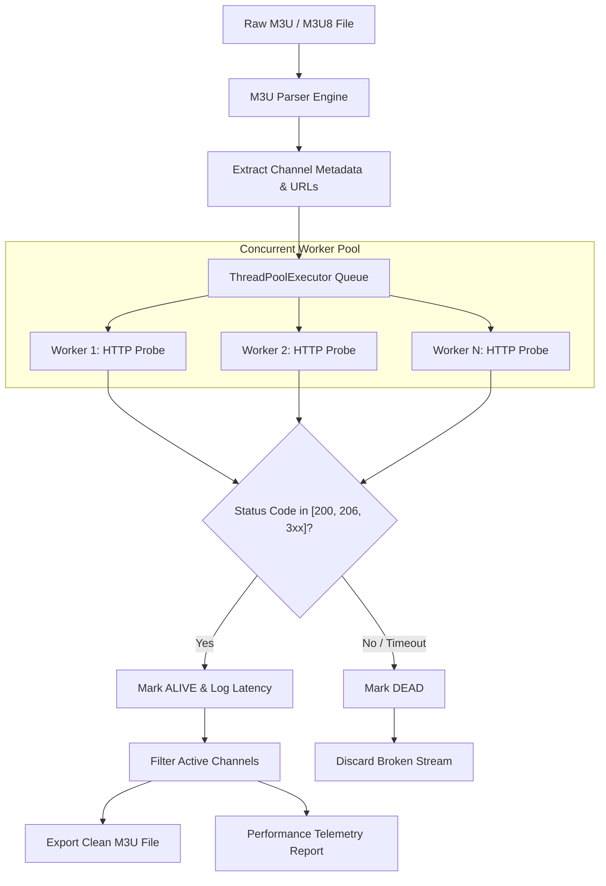
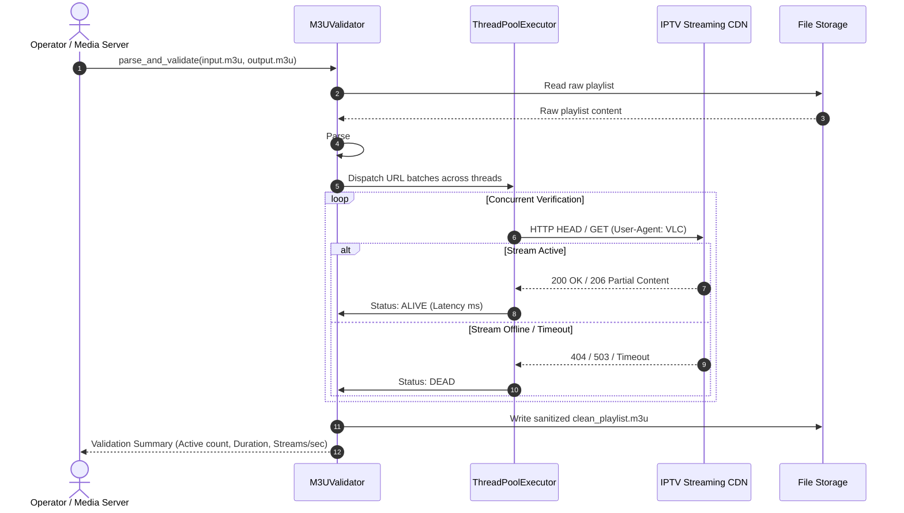

# 📺 iptv-m3u-validator

[](https://github.com/MobileConduit/iptv-m3u-validator/actions)
[](https://www.python.org/)
[](LICENSE)
[](https://github.com/MobileConduit)

A high-speed, enterprise-grade concurrent validator and sanitizer for IPTV `M3U` and `M3U8` playlists. It concurrently tests media stream endpoints, identifies dead links, tracks live latency and throughput metrics, and generates sanitised, production-ready playlists for IPTV middleware, VLC, Plex, and media players.

---

## 🌟 Key Features

- **Concurrent Verification Engine:** Configurable thread pool workers for ultra-fast validation of large playlists (thousands of channels in seconds).
- **Intelligent Fallback Probing:** Executes lightweight HTTP `HEAD` probes with automatic fallback to byte-range `GET` requests for restrictive CDN edges.
- **Latency & Performance Metrics:** High-resolution stream latency measurement, throughput calculation (streams/second), and structured logging.
- **Metadata Preservation:** Retains all `#EXTINF` metadata attributes (`tvg-id`, `tvg-name`, `tvg-logo`, `group-title`, and channel names).
- **Clean Export:** Exports clean, dead-link-free playlists with valid `#EXTM3U` headers.
- **Automated CI/CD:** GitHub Actions test matrix across Python 3.10, 3.11, and 3.12 with complete test coverage.

---

## 🏗️ Architecture & Workflow

### Stream Validation Lifecycle



### Validation Sequence Diagram



---

## 🚀 Quick Start

### Prerequisites
- Python 3.10 or higher
- Optional: Virtual environment (`venv`)

### Installation

```bash
# Clone the repository
git clone https://github.com/MobileConduit/iptv-m3u-validator.git
cd iptv-m3u-validator

# Copy environment configuration
cp .env.example .env

# Install optional test dependencies
pip install -r requirements.txt
```

### Basic CLI Usage

```bash
# Validate playlist using default settings
python validator.py --input samples/sample_playlist.m3u --output clean_playlist.m3u

# High-concurrency validation with custom timeout
python validator.py --input channels.m3u --output clean_channels.m3u --threads 50 --timeout 3
```

### CLI Arguments

| Argument | Flag | Default | Description |
|---|---|---|---|
| `--input` | `-i` | *(Required)* | Path to input `.m3u` or `.m3u8` playlist file |
| `--output` | `-o` | `clean_playlist.m3u` | Target file path for the sanitized playlist |
| `--threads` | `-t` | `20` | Number of concurrent worker threads |
| `--timeout` | | `4` | Network socket timeout in seconds |

---

## ⚙️ Configuration (`.env`)

Configure default parameters via `.env` or system environment variables:

```env
DEFAULT_MAX_WORKERS=25
DEFAULT_TIMEOUT=5
USER_AGENT=Mozilla/5.0 (VLC/3.0.18; Windows NT 10.0; Win64; x64)
LOG_LEVEL=INFO
```

---

## 🧪 Automated Testing

Run the test suite using `unittest` or `pytest`:

```bash
# Run with Python standard unittest
python -m unittest discover tests

# Run with pytest and coverage reporting
pytest --cov=validator tests/
```

---

## 👤 Author & Maintainer

**Eng. MHD. Shadi AL-Hasan**  
- **Role:** Executive CTO & Enterprise Solutions Architect  
- **Email:** [mhd.shadi.alhasan@gmail.com](mailto:mhd.shadi.alhasan@gmail.com)  
- **Phone / WhatsApp:** [+963934005922](tel:+963934005922)  
- **Location:** Damascus, Syria  
- **GitHub:** [MobileConduit](https://github.com/MobileConduit)  

---

## 📄 License

This project is licensed under the MIT License - see the [LICENSE](LICENSE) file for details.  
Copyright (c) 2026 **MHD. Shadi AL-Hasan**. All rights reserved.
